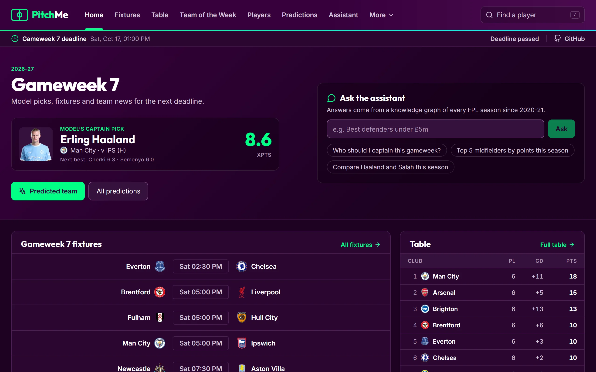
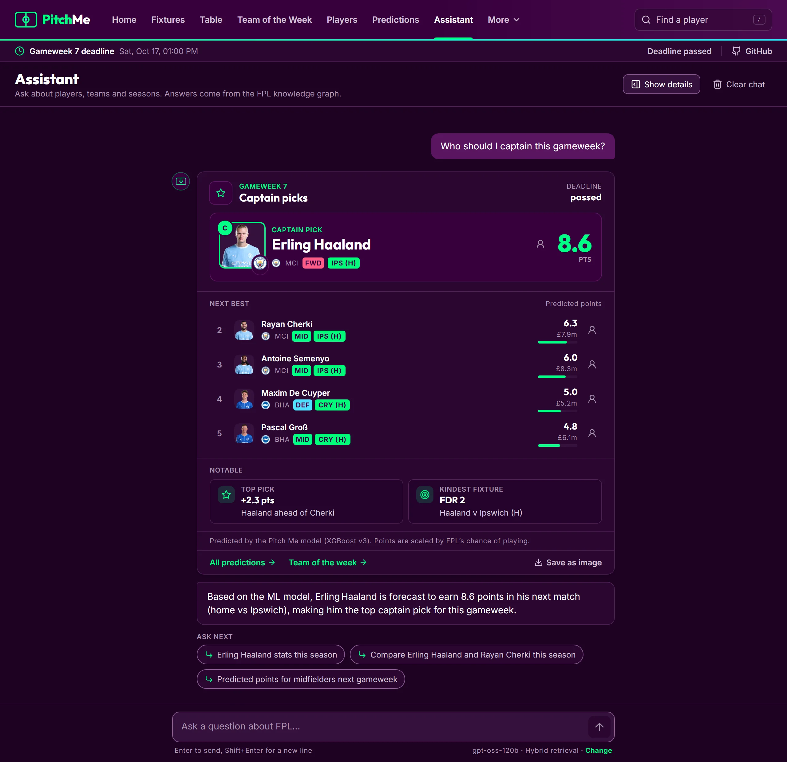
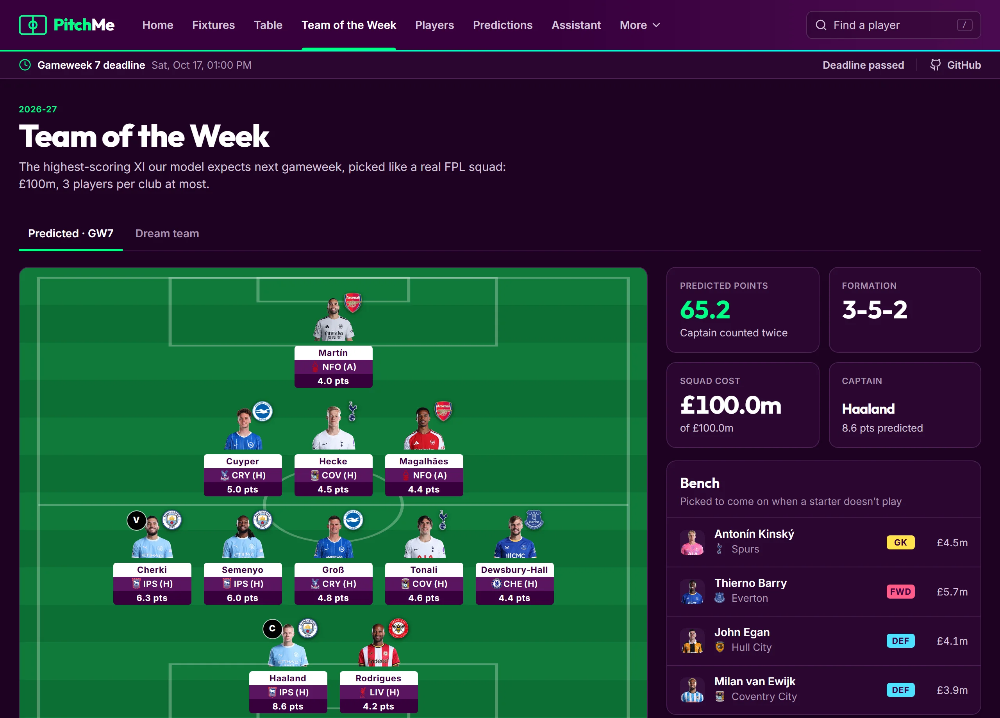
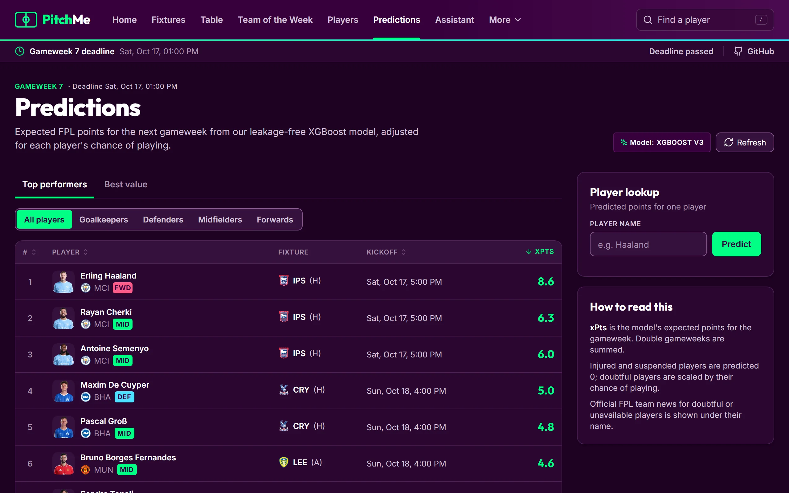
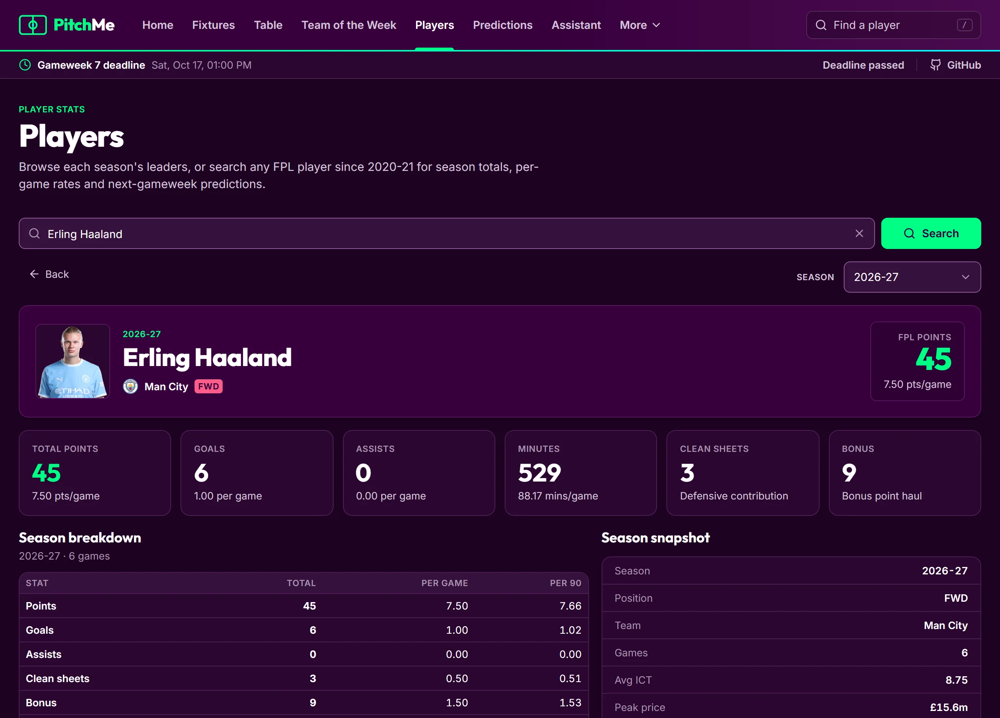
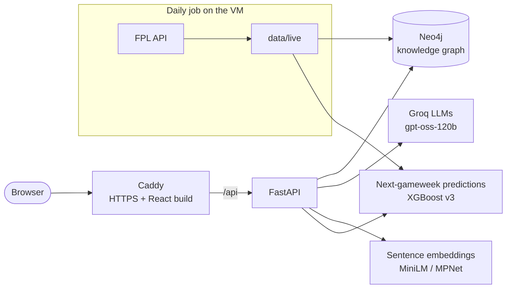

# Pitch Me

**A Fantasy Premier League assistant that answers questions from a knowledge graph, predicts next week's points with its own model, and picks the best squad for the budget.**

**Live site: [pitchme.polandcentral.cloudapp.azure.com](https://pitchme.polandcentral.cloudapp.azure.com/)**



Ask *"Who should I captain this gameweek?"* or *"Who scored the most goals in 2022-23?"*. The question is routed to a parameterized Cypher query over a Neo4j graph of every FPL season since 2020-21: about 2,300 players, 2,660 fixtures and 185,000 relationships. Embeddings handle the fuzzy cases. An LLM writes the answer, while the stat cards beside it come straight from the query results, so their numbers can't be hallucinated. The current season refreshes every day from the official FPL API, and a custom XGBoost model, checked for leakage, predicts every player's points for the next gameweek.

## Features

- **Assistant**: natural-language Q&A over seven seasons, streamed token by token, with visual answer cards (player, comparison, leaderboard, captain picks, fixtures, a pitch view) and suggested follow-ups. Each card can be saved or shared as an image.
- **Predictions**: expected points for every player next gameweek, scaled by FPL's chance-of-playing flags, plus a best-value view.
- **Team of the Week**: the highest-scoring legal FPL squad the model expects (£100m, at most 3 per club), or the actual dream team of a past gameweek.
- **Players and Compare**: profiles with season totals, per-game and per-90 rates and next-gameweek predictions, plus head-to-head comparisons.
- **Season dashboard**: fixtures, a league table computed from results, injuries and team news, and the next deadline.
- **Trivia**: quiz questions generated from the graph.

| Assistant | Team of the Week |
| --- | --- |
|  |  |
| **Predictions** | **Player profile** |
|  |  |

## How it works



**The assistant's pipeline** (`POST /api/query/stream`):

1. **Understand the question.** A rule-based intent classifier and an entity extractor find the players, clubs, seasons, stats and positions. Player names resolve through an in-memory index that ignores accents and corrects typos word by word, so "haalnd" finds Haaland and "Odegaard" finds Ødegaard.
2. **Retrieve.** The intent maps to one of 32 parameterized Cypher queries. In hybrid mode, a semantic search over prebuilt embeddings of player-season summaries adds context.
3. **Answer.** The LLM gets the query results in its prompt and streams its answer as server-sent events. If a model runs out of quota or is retired, the request moves to the next one in a fallback chain.
4. **Show the data.** While the LLM writes, answer cards are built from the query rows and a few small lookups, never from the LLM's text. They usually reach the browser before the first word of the answer.

## Engineering highlights

**A points model that survived a leakage audit.** The first model scored well, but an audit showed why: its feature pipeline duplicated rows about 27 times, and FPL's historical "expected points" field had been recorded *during* each gameweek, once lineups were known. Version 3 was rebuilt with one row per player per fixture and features drawn only from earlier gameweeks, and tests enforce both. On held-out seasons, its top 20 picks per gameweek average **4.70 points [95% CI 4.40–5.02]**, versus 4.14 for the best simple baseline and 1.39 for a random pick. The captain pick averages 6.61 points against 5.59, though that gap isn't statistically significant. The [full evaluation](docs/ml_evaluation/README.md) covers the protocol, bootstrap confidence intervals, ablations and the leakage checks.

**Experiments run like experiments.** Each candidate feature goes through a backtest workflow: four held-out seasons, three seeds, paired bootstrap intervals, plus subsets such as newly promoted clubs. Most ideas didn't beat the current model and were left out, including per-90 rate features, recency weighting, manager-change features and head-to-head history. Training and backtests run in GitHub Actions. On the server, the model retrains every Monday, and a new candidate replaces the live one only if it beats every baseline on held-out data.

**Squad selection as an optimisation problem.** Team of the Week solves a mixed-integer linear program with SciPy (`milp`): 15 players, £100m, at most three per club, a valid formation, and the captain's points counted twice. The bench is weighted by how often each substitute actually plays, so spare money buys substitutes who will play rather than the cheapest ones available.

**A live season, refreshed daily.** A timer on the server fetches the FPL API, applies it to the graph idempotently (about 10 seconds), regenerates predictions and hot-reloads the API. Fixtures carry FPL's difficulty ratings, injured or suspended players are predicted 0, and doubtful ones are scaled by their chance of playing.

**Self-hosted on one small VM.** Caddy (automatic HTTPS), FastAPI and Neo4j run under Docker Compose on a 4 GB Ubuntu VM. Every push to `main` deploys through GitHub Actions over SSH, and the images build on both x86_64 and arm64. If Neo4j isn't up yet after a reboot, the backend waits for it and connects when it's ready, instead of crashing.

**Details that matter in production.** Admin endpoints stay hidden (404) unless an admin token is configured, and reject requests that don't send it. Query endpoints have a rate limit per client. The image proxy only fetches from allow-listed hosts and checks every redirect. Page-view counting is cookie-free, stores no personal data, only runs after consent, and respects Global Privacy Control.

**Frontend.** React and TypeScript with a token-based design system (`/design` shows every component). Answer cards use CSS container queries so they adapt when the chat column narrows. Answers are announced to screen readers without reading out every card, and each route is code-split. Every page sets its own title and description, and the build generates the sitemap and social preview tags.

**Tests.** More than 500 pytest tests, including Hypothesis property tests, tests that check the model features for leakage, and tests for the optimiser, the data pipeline and the Cypher that each query generates.

## Tech stack

| Area | Tools |
| --- | --- |
| Frontend | React 18, TypeScript, Vite, Tailwind CSS, TanStack Query, Zustand, Recharts |
| Backend | Python 3.11, FastAPI, spaCy, rapidfuzz |
| Data | Neo4j 5 (Cypher), the official FPL API, historical FPL data from 2020-21 |
| AI / ML | Groq (gpt-oss-120b, gpt-oss-20b, Qwen 3), sentence-transformers, XGBoost, SciPy MILP |
| Infrastructure | Docker Compose, Caddy, GitHub Actions, Ubuntu VM on Azure |

## Run it locally

### Frontend only (about a minute)

Run the UI on your machine against the live API, with no backend or database:

```bash
npm install
npm run dev:live
```

Then open http://localhost:3000.

### Full stack

You need Docker, Python 3.11+, Node 18+ and a free [Groq API key](https://console.groq.com).

```bash
# 1. Neo4j on bolt://localhost:7687 (user neo4j, password "password")
docker compose up -d neo4j

# 2. Python environment (on Windows, activate with .venv\Scripts\activate)
python -m venv .venv
source .venv/bin/activate
pip install torch --index-url https://download.pytorch.org/whl/cpu   # optional: skips the large CUDA build
pip install -r requirements.txt
python -m spacy download en_core_web_sm
```

Create `.env` in the repo root:

```env
NEO4J_URI=bolt://localhost:7687
NEO4J_USER=neo4j
NEO4J_PASSWORD=password
GROQ_API_KEY=gsk_your_key_here
```

```bash
# 3. Build the graph from data/ (wipes the database first; about 30 s locally)
python load_data.py

# Optional: pull the current season from the FPL API and predict the next gameweek
python -m pipeline.current_season
python -m pipeline.load_current
python -m pipeline.predict_next_gw

# 4. API on :8000
uvicorn api_main:app --reload --port 8000

# 5. Frontend on :3000, in another terminal (proxies /api to :8000)
npm install
npm run dev
```

Run the tests with `pip install -r requirements-dev.txt`, then `python -m pytest tests`. To deploy on your own VM, see [deploy/README.md](deploy/README.md).

## Project structure

```
api_main.py        FastAPI app: routes and startup
load_data.py       builds or reloads the Neo4j graph
src/               React frontend (pages/, components/ui design system, services/api.ts)
graph/             Neo4j connection, schema, loader and the Cypher query library
preprocessing/     intent classifier and entity extractor
llm/               LLM manager (Groq, fallbacks, streaming) and prompt templates
embeddings/        sentence-transformer retrieval and prebuilt embeddings
services/          answer cards, player index, avatars, season dashboard, squad optimiser
pipeline/          daily job: FPL API -> data/live -> graph -> predictions, weekly retrain
ml/                points model v3: features, training, evaluation
tests/             pytest suite
deploy/            production Docker Compose, Caddy, VM setup and deploy scripts
scripts/           one-off tools (data prep, analysis, backtests, site images)
docs/              ML evaluation, design notes, reports
```

## Background

Pitch Me began in December 2025 as a university team project: a Graph-RAG question-answering assistant over FPL data. Since then it has grown into a live product. The current season updates daily, the prediction model was rebuilt and evaluated, Team of the Week was added, the site was redesigned, and it moved to self-hosting.

The screenshots come from the live site and are regenerated with `node scripts/site/screenshots.mjs`.

## Disclaimer and license

Pitch Me is a fan-made project. It is not affiliated with, endorsed by or connected to the Premier League or Fantasy Premier League.

MIT License.
