# Evaluation of the v3 points model

Generated by `python -m ml.evaluate_points_v3` on 2026-10-15T02:57:57+00:00 (git `012f5e8`, runtime 185s). Every number below is read from [`metrics.json`](metrics.json); rerun the script to refresh both.

## Summary

- **Top-20 picks:** on the held-out test seasons (2025-26 + 2026-27, 44 gameweeks) the 20 players v3 rates highest each gameweek score **4.70 [4.40, 5.02]** points each (95% CI), versus 4.14 for the best simple baseline (season pts/game) and 1.39 for a random pick. Difference **+0.56 [0.31, 0.83]**, significant at 5%; v3 wins 30 of 43 decided gameweeks (sign test p = 0.014).
- **Headroom:** perfect hindsight would average 11.20 for top-20; v3 closes 34% of the gap between random picks and that oracle (season pts/game: 28%).
- **Captain (top-1):** 6.61 vs 5.59 points (difference +1.02 [-0.23, 2.36], not significant at 5%). Single picks are noisy: the CI is wide.
- **Accuracy:** test MAE 1.007 / RMSE 1.946 / R² 0.332, versus MAE 1.097 / R² 0.203 for season pts/game. Overall bias is -0.046. On rows where the player did play (40%), predictions are 0.69 points low on average (they are expectations that include the chance of not playing) and correlate r = 0.29 with the outcome.
- **Rank correlation:** mean per-gameweek Spearman 0.718 vs 0.706 for the last-3 average. Spearman is dominated by separating non-playing from playing players, which simple form already does; v3's advantage is at the top of the table.
- **Points are noisy:** 60% of rows are 0-minute non-appearances; even a model given the match's own minutes and xG/xA reaches only R² 0.55, and the between-player-season share of variance is 0.32. v3's R² of 0.33 is about what knowing every player's true season average would give, without knowing that average.
- **No leakage found:** 166,965 feature rows for 166,965 input rows; scrambling every outcome from 2025-26 GW>=20 onwards changed 0 of 148,300 earlier feature rows; the strongest single feature correlates 0.54 with the target. The legacy v2 pipeline inflated rows 27x.
- **Ablations** (3 seeds each): the biggest loss comes from *form only (+ position)* (-0.39 [-0.60, -0.19] top-20 points). Significant losses: without price & ownership rank, form only (+ position), rolling window 6 only.
- **Training noise:** across 5 XGBoost seeds, top-20 is 4.69 ± 0.03 and captain 6.74 ± 0.34. The headline uses seed 0, which is what `ml/train_points_v3.py` trains.

## Task and data

The model predicts a player's FPL points for one fixture, before the gameweek deadline. The app uses the predictions to rank players (best picks, captain, best value), so pick quality matters more than squared error.

| Season | Rows (player x fixture) | Gameweeks | Role |
|---|---|---|---|
| 2020-21 | 24,365 | 38 | train |
| 2021-22 | 25,447 | 38 | train |
| 2022-23 | 26,505 | 37 | train |
| 2023-24 | 29,725 | 38 | train |
| 2024-25 | 27,283 | 38 | validation (early stopping) |
| 2025-26 | 29,757 | 38 | test |
| 2026-27 | 3,883 | 6 | test |

Sources: `data/cleaned_merged_seasons_cleaned.csv` (2020-21 to 2025-26) and the current-season file `data/live/FPL_2026_2027.csv` (2026-27 GW1-6), loaded with `ml.points_model.load_history` exactly as in training. Features: 72 columns from `ml.points_model.feature_columns()`.

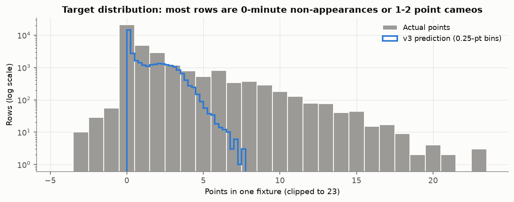

## Protocol

- **Temporal split, as in `ml/train_points_v3.py`:** train 2020-21, 2021-22, 2022-23, 2023-24; early stopping on 2024-25 (best iteration 111 trees); test 2025-26 and 2026-27. Hyperparameters are `ml.points_model.XGB_PARAMS`, chosen on the validation season. Ablations and seed repeats use the same split. The last-match and 20-match team-strength features were added in October 2026 after a rolling-origin backtest (`scripts/analysis/ml_backtest.py`) whose folds include the test seasons; they also win on the 2023-24 and 2024-25 folds alone, but the test numbers are no longer fully untouched.
- **No-leakage design:** one row per player per fixture; player features use only earlier gameweeks (a double gameweek's two fixtures share the pre-deadline values); team strength comes from a separate team-per-match table, also rolled over earlier gameweeks; FPL's historical xP is not a feature (it was recorded inside the gameweek).
- **Metrics:** regression metrics per row (player x fixture). Pick metrics per gameweek after summing a player's double-gameweek fixtures: top-k = mean actual points of the k highest predictions; captain = top-1; hit@20 = share of our top 20 who scored at least the gameweek's 20th-best score; oracle = ranking by actual points. Gameweek values are averaged with equal weight.
- **Baselines on identical rows:** zero (equivalent to a random pick for ranking), training-set position mean, last-3 and last-6 average points, and season-to-date points per game (falling back to last-6, then 0, before a player's first match of the season). Missing histories fall back to 0, so every method is scored on the same 33,640 rows. (The training report drops rows a baseline cannot score, so its baseline numbers differ slightly.)
- **Uncertainty:** 2000 bootstrap resamples of gameweeks, stratified by season, fixed seed 42. Paired differences resample the same gameweeks for both methods.

## Results vs baselines

Combined test seasons (44 gameweeks, 33,640 rows). Bias = mean(predicted - actual).

| Method | MAE | RMSE | R² | Bias | MAE (played) | Bias (played) | r (played) | Spearman | Captain | Top-10 | Top-20 | Top-50 | Hit@20 |
|---|---|---|---|---|---|---|---|---|---|---|---|---|---|
| **v3 (XGBoost)** | 1.007 | 1.946 | 0.332 | -0.046 | 1.965 | -0.689 | 0.287 | 0.718 | 6.61 | 5.11 | 4.70 | 4.17 | 0.20 |
| Season pts/game | 1.097 | 2.126 | 0.203 | 0.021 | 2.150 | -0.560 | 0.213 | 0.676 | 5.59 | 4.33 | 4.14 | 3.75 | 0.16 |
| Last-6 avg | 1.090 | 2.140 | 0.192 | -0.006 | 2.204 | -0.555 | 0.198 | 0.684 | 4.75 | 3.95 | 3.96 | 3.68 | 0.15 |
| Last-3 avg | 1.087 | 2.207 | 0.141 | -0.009 | 2.315 | -0.442 | 0.186 | 0.706 | 4.05 | 4.01 | 3.77 | 3.62 | 0.13 |
| Position mean | 1.540 | 2.379 | 0.002 | -0.000 | 2.091 | -1.789 | -0.038 | 0.080 | 2.34 | 1.52 | 1.53 | 1.36 | 0.05 |
| Zero / random pick | 1.196 | 2.661 | -0.249 | -1.188 | 3.014 | -2.992 | 0.001 | 0.014 | 2.39 | 1.33 | 1.39 | 1.28 | 0.04 |
| Oracle (hindsight) |  |  |  |  |  |  |  | 1 | 17.41 | 12.97 | 11.20 | 8.61 | 1 |

"Played" = the 13,351 rows with minutes > 0. Every method is biased low there because it is scored against outcomes conditional on playing; r shows how well it orders those players.

Per test season:

| Season | Method | MAE | R² | Spearman | Captain | Top-20 | Hit@20 |
|---|---|---|---|---|---|---|---|
| 2025-26 | **v3 (XGBoost)** | 0.979 | 0.336 | 0.724 | 6.21 | 4.66 | 0.19 |
| 2025-26 | Season pts/game | 1.065 | 0.226 | 0.684 | 6.11 | 4.17 | 0.17 |
| 2025-26 | Last-6 avg | 1.052 | 0.203 | 0.702 | 5.05 | 3.95 | 0.15 |
| 2025-26 | Last-3 avg | 1.053 | 0.147 | 0.721 | 4.39 | 3.78 | 0.13 |
| 2025-26 | FPL xP (leaky) | 1.070 | -0.017 | 0.760 | 3.68 | 2.65 | 0.13 |
| 2025-26 | Oracle (hindsight) |  |  |  | 17.34 | 11.19 |  |
| 2026-27 | **v3 (XGBoost)** | 1.222 | 0.302 | 0.680 | 9.17 | 4.92 | 0.23 |
| 2026-27 | Season pts/game | 1.343 | 0.047 | 0.622 | 2.33 | 3.94 | 0.14 |
| 2026-27 | Last-6 avg | 1.379 | 0.115 | 0.571 | 2.83 | 4.01 | 0.16 |
| 2026-27 | Last-3 avg | 1.343 | 0.091 | 0.610 | 1.83 | 3.77 | 0.14 |
| 2026-27 | Oracle (hindsight) |  |  |  | 17.83 | 11.28 |  |

FPL's historical xP is shown for 2025-26 for completeness only. It is not a fair baseline: in these files it was recorded inside the gameweek (see the leakage audit), and in 2025-26 it does not behave like the pre-deadline `ep_next` the app sees at prediction time.

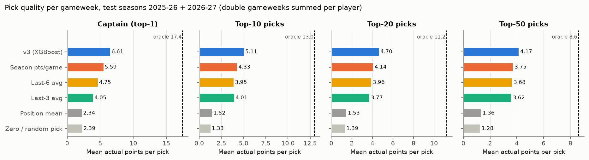

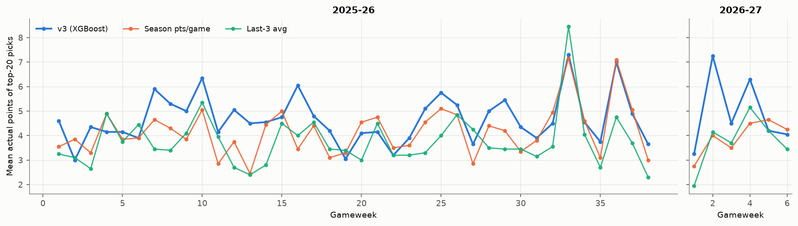

## Significance

Best honest baseline by combined top-20: **Season pts/game**. 95% bootstrap CIs:

| Scope | v3 top-20 | Season pts/game top-20 | Δ top-20 | p (Δ top-20) | Δ captain | Δ Spearman | Δ MAE | GWs won-lost |
|---|---|---|---|---|---|---|---|---|
| 2025-26 | 4.66 [4.36, 4.98] | 4.17 [3.86, 4.50] | +0.50 [0.26, 0.75] | < 0.0005 | +0.11 [-1.08, 1.29] | +0.039 [0.028, 0.053] | -0.086 [-0.097, -0.074] | 26-11 |
| 2026-27 | 4.92 [3.91, 6.10] | 3.94 [3.38, 4.40] | +0.98 [0.05, 2.06] | 0.032 | +6.83 [1.67, 14.17] | +0.058 [0.031, 0.096] | -0.120 [-0.182, -0.067] | 4-2 |
| combined | 4.70 [4.40, 5.02] | 4.14 [3.86, 4.43] | +0.56 [0.31, 0.83] | < 0.0005 | +1.02 [-0.23, 2.36] | +0.042 [0.032, 0.054] | -0.089 [-0.103, -0.077] | 30-13 |

Top-20 difference against every baseline (combined): Season pts/game +0.56 [0.33, 0.80]; Last-6 avg +0.74 [0.55, 0.95]; Last-3 avg +0.93 [0.65, 1.20]; Position mean +3.17 [2.86, 3.50].

The 2026-27 interval rests on only 6 gameweeks, so treat it as indicative.

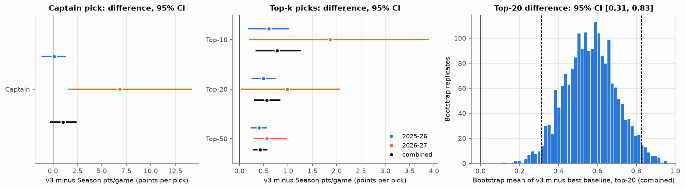

## Breakdowns

Row-level accuracy and within-group pick quality (top-10 within the group, per gameweek):

| Split | Group | Rows | Played | v3 MAE | v3 bias | Season pts/game MAE | v3 Spearman | v3 top-10 | Season pts/game top-10 | Oracle top-10 |
|---|---|---|---|---|---|---|---|---|---|---|
| Position | GK | 3,852 | 23% | 0.633 | 0.030 | 0.665 | 0.680 | 3.67 | 3.33 | 5.29 |
| Position | DEF | 11,005 | 42% | 1.143 | -0.160 | 1.270 | 0.666 | 4.18 | 3.86 | 10.07 |
| Position | MID | 15,036 | 41% | 0.976 | -0.010 | 1.065 | 0.734 | 4.63 | 4.12 | 10.92 |
| Position | FWD | 3,747 | 44% | 1.119 | 0.064 | 1.155 | 0.761 | 4.15 | 3.80 | 7.14 |
| Price | <5.0 | 20,350 | 26% | 0.654 | -0.046 | 0.687 | 0.629 | 3.54 | 3.31 | 9.67 |
| Price | 5.0-5.9 | 9,272 | 57% | 1.333 | -0.105 | 1.508 | 0.676 | 4.13 | 3.75 | 9.98 |
| Price | 6.0-7.4 | 3,032 | 69% | 1.813 | 0.099 | 1.996 | 0.637 | 4.34 | 4.00 | 8.36 |
| Price | 7.5+ | 986 | 76% | 2.740 | 0.050 | 2.908 | 0.511 | 4.89 | 4.36 | 6.66 |
| Venue | home | 16,828 | 40% | 1.039 | -0.078 | 1.113 | 0.724 | 4.90 | 4.44 | 11.32 |
| Venue | away | 16,812 | 40% | 0.975 | -0.015 | 1.080 | 0.710 | 4.35 | 3.88 | 10.77 |

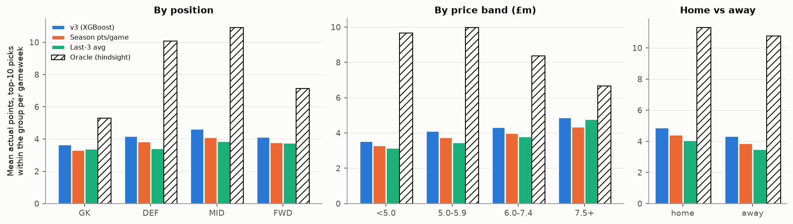

**Double gameweeks** in the test data: 2025-26 GW26 (2 teams), 2025-26 GW33 (6 teams), 2025-26 GW36 (2 teams). Per fixture, v3's MAE is 0.958 on double-gameweek rows vs 1.008 on single ones (bias +0.011 vs -0.048). Because a player's fixtures are summed, every method heavily favours doubling players: they are 16% of players in those gameweeks, 47% of the real top 20, and 90% of v3's top 20 (season pts/game: 88%). Top-20 in double gameweeks: v3 6.52, season pts/game 6.37, oracle 12.47 (other gameweeks: v3 4.57, season pts/game 3.97).

**Early season vs the rest** (in GW1-5 season-to-date stats are thin and rolling form spans the summer break):

| Scope | Phase | GWs | v3 top-20 | Season pts/game top-20 | Last-3 top-20 | Oracle top-20 | v3 Spearman | Season pts/game Spearman |
|---|---|---|---|---|---|---|---|---|
| 2025-26 | GW1-5 | 5 | 4.05 | 3.89 | 3.53 | 10.89 | 0.695 | 0.644 |
| 2025-26 | GW6+ | 33 | 4.76 | 4.21 | 3.81 | 11.24 | 0.728 | 0.691 |
| 2026-27 | GW1-5 | 5 | 5.10 | 3.88 | 3.83 | 11.40 | 0.678 | 0.615 |
| 2026-27 | GW6+ | 1 | 4.05 | 4.25 | 3.45 | 10.65 | 0.690 | 0.656 |
| combined | GW1-5 | 10 | 4.58 | 3.88 | 3.68 | 11.14 | 0.686 | 0.629 |
| combined | GW6+ | 34 | 4.74 | 4.21 | 3.80 | 11.22 | 0.727 | 0.690 |

## Calibration

Predicted-points deciles against mean actual points. Linear fit of actual on predicted: v3 slope 1.07 (intercept -0.03); season pts/game 0.72; last-3 0.62. A slope near 1 means the predictions can be read as expected points; raw form averages are over-dispersed (slope well below 1) because they don't shrink towards the mean.

In the top decile v3 predicts 3.81 and players score 3.87 on average. By position: GK slope 1.06; DEF slope 1.16; MID slope 1.04; FWD slope 1.00.

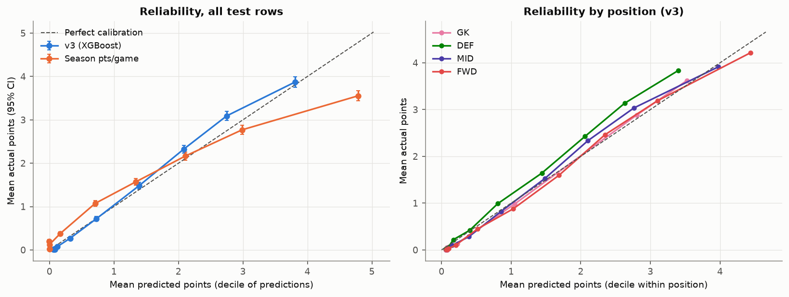

## Feature importance

Gain is measured on the early-stopped model (111 trees); permutation importance shuffles one column of the test set (3 repeats) and records the MAE increase (base MAE 1.007) and the drop in top-20 points (base 4.70).

| Rank | Gain (share) | Permutation (ΔMAE, Δtop-20) |
|---|---|---|
| 1 | minutes_r1 (0.458) | minutes_r1 (+0.1982, +0.37) |
| 2 | minutes_r3 (0.100) | minutes_r3 (+0.0569, -0.02) |
| 3 | selected_rank (0.050) | season_ppg (+0.0470, +0.04) |
| 4 | season_ppg (0.046) | season_minutes_share (+0.0394, -0.02) |
| 5 | price (0.036) | ict_index_r3 (+0.0313, -0.08) |
| 6 | ict_index_r3 (0.030) | minutes_r6 (+0.0307, -0.05) |
| 7 | opp_gf20 (0.023) | selected_rank (+0.0219, +0.22) |
| 8 | ict_index_r6 (0.022) | bps_r6 (+0.0163, -0.03) |
| 9 | opp_ga20 (0.016) | played_r3 (+0.0160, +0.00) |
| 10 | total_points_r3 (0.013) | creativity_r6 (+0.0094, +0.02) |

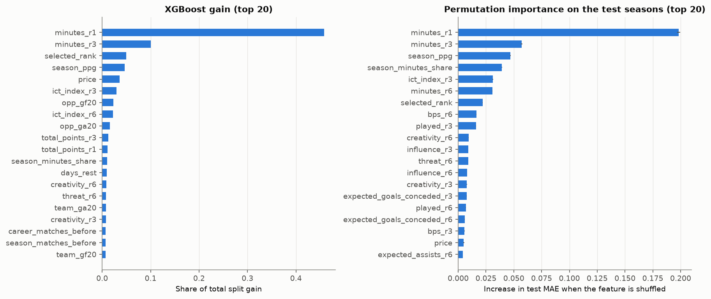

Group-level view (columns of a group shuffled together):

| Group | Features | Gain share | ΔMAE when shuffled | Top-20 drop |
|---|---|---|---|---|
| Form (last match, rolling 3/6) | 43 | 0.727 | +0.4766 | +1.51 |
| Price & ownership | 2 | 0.086 | +0.0452 | +0.49 |
| Season to date | 4 | 0.071 | +0.0395 | +0.01 |
| Team / opponent strength | 16 | 0.096 | +0.0057 | +0.15 |
| Fixture context | 3 | 0.017 | +0.0029 | -0.03 |
| Position | 4 | 0.003 | +0.0010 | +0.01 |

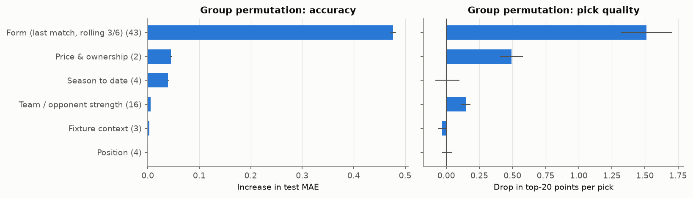

## Ablations

Each variant is retrained from scratch under the same protocol (train 2020-21..2023-24, early stopping on 2024-25) with XGBoost seeds [0, 1, 2]. Metrics are averaged over the seeds (per gameweek for pick metrics), and the CI is a paired gameweek bootstrap against the full model averaged the same way, so the full-model row here is a seed average and differs slightly from the headline (seed 0).

| Variant | Features | Trees | Valid top-20 | Test MAE | Test R² | Spearman | Captain | Top-20 | Δ top-20 vs full |
|---|---|---|---|---|---|---|---|---|---|
| Full model | 72 | 111/117/114 | 4.95 | 1.006 | 0.331 | 0.717 | 6.54 | 4.69 |  |
| Without team/opponent strength | 56 | 110/116/114 | 5.01 | 1.009 | 0.325 | 0.718 | 6.88 | 4.56 | -0.13 [-0.27, 0.01] |
| Without price & ownership rank | 70 | 108/121/104 | 4.96 | 1.006 | 0.323 | 0.710 | 5.58 | 4.49 | -0.20 [-0.32, -0.08] |
| Without fixture context | 69 | 114/104/124 | 5.06 | 1.009 | 0.329 | 0.717 | 6.74 | 4.66 | -0.03 [-0.11, 0.05] |
| Without season-to-date | 68 | 137/114/115 | 5.01 | 1.006 | 0.327 | 0.713 | 6.33 | 4.67 | -0.02 [-0.10, 0.06] |
| Form only (+ position) | 47 | 102/110/110 | 4.70 | 1.017 | 0.304 | 0.703 | 4.57 | 4.30 | -0.39 [-0.60, -0.19] |
| Without last-match features | 69 | 97/117/131 | 5.02 | 1.022 | 0.319 | 0.708 | 6.70 | 4.59 | -0.10 [-0.20, 0.00] |
| Without 20-match team strength | 64 | 102/115/102 | 5.03 | 1.014 | 0.328 | 0.717 | 6.76 | 4.61 | -0.08 [-0.18, 0.02] |
| Rolling window 3 only | 49 | 108/111/100 | 5.01 | 1.027 | 0.319 | 0.707 | 6.90 | 4.67 | -0.02 [-0.13, 0.09] |
| Rolling window 6 only | 49 | 110/94/112 | 4.96 | 1.049 | 0.299 | 0.691 | 6.11 | 4.55 | -0.14 [-0.23, -0.04] |

Seed stability (full model, seeds [0, 1, 2, 3, 4]): top-20 4.693 ± 0.033 (range 4.651-4.725), MAE 1.0072 ± 0.0027, captain 6.74 ± 0.34. Seed 0 (the training script's default) gives 4.700, so the headline top-20 is within the seed range. Seed-averaged ablation differences smaller than about one seed standard deviation should be read as noise even when their CI excludes 0.

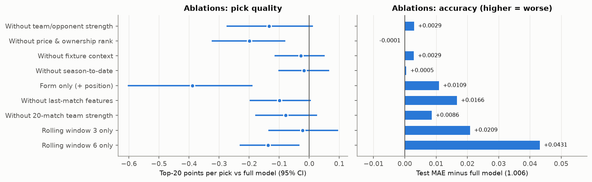

## Leakage audit

1. **One feature row per input row.** `build_features` returned 166,965 rows for 166,965 input rows (identical); every input row id appears exactly once (0 duplicated ids).
2. **No look-ahead (perturbation test).** 2025-26 GW>=20: 22 outcome columns shuffled (15,572 rows), then rebuilt the features. Rows up to and including that gameweek changed: **0 of 148,300** (0 of 790 at the gameweek itself). Power check: 795 of 795 rows of the following gameweek changed, as they should.
3. **No suspiciously strong single feature.** Highest |Pearson r| with the target on the test seasons: `minutes_r1` 0.537, `minutes_r3` 0.535, `season_minutes_share` 0.523, `played_r3` 0.517, `minutes_r6` 0.515 (training seasons: `minutes_r3` 0.490). For contrast, FPL's xP correlates 0.69 (2023-24), 0.66 (2024-25), 0.35 (2025-26).
4. **Rank by a single column.** This is the test that exposed the xP leak: a pre-deadline signal should not pick much better than the best honest feature.

| Season | xP alone top-20 | Best honest single feature | v3 top-20 | Oracle top-20 | corr(xP, points) |
|---|---|---|---|---|---|
| 2023-24 | 7.34 | ict_index_r6 (4.64) | n/a | 11.28 | 0.690 |
| 2024-25 | 6.69 | ict_index_r6 (4.56) | 4.97 | 10.86 | 0.662 |
| 2025-26 | 2.65 | selected_rank (4.25) | 4.66 | 11.19 | 0.347 |
| 2026-27 | n/a | selected_rank (4.82) | 4.92 | 11.28 | n/a |

v3 is shown only where it is out of sample (2024-25 is the early-stopping season, so mildly optimistic). In the seasons where xP ranks far above every honest feature and above v3, it carries same-gameweek information (team news/lineups), so it cannot be a feature or a fair baseline.

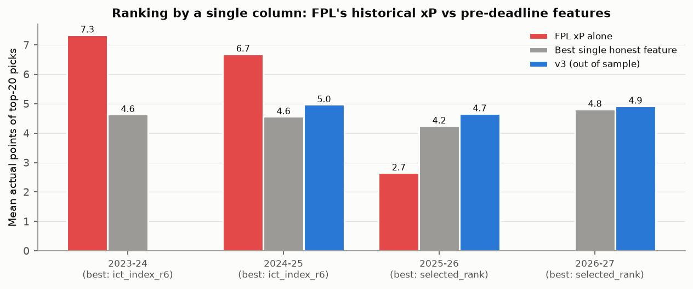

5. **Validation vs test consistency.** Train (in-sample) MAE 0.991 / top-20 6.64; validation 1.007 / 4.97; test 1.007 / 4.70. Row-level error is nearly the same in and out of sample, so the model is not memorising rows. Pick quality is higher in-sample, as expected for trees that have seen those hauls. The validation top-20 is above the test seasons' even though 2024-25's oracle is lower (10.86 vs 11.20): part of that gap is the mild optimism of early-stopping on that season, part is season-to-season variation. There is no sign of the near-perfect in-sample fit that leakage produces.
6. **Why the legacy v2 numbers (R² 0.72-0.87) were inflated.** Running the old `FeatureEngineer` on 2022-23 turns 26,505 rows into 721,933 (**27.2x**): its opponent-strength merges join per-player values on (season, team, GW). The `shift(-1)` "next match" target then mostly lands on a copy of the same match: for rows scoring 5+ points the target equals the row's own points 97% of the time, against 6% for a player's genuine next match. Together with context features describing the previous match and the leaky xP, that explains the R² far above the 0.55 that even same-match minutes and xG allow.

## Error analysis

- **Availability is the largest error source.** 0-minute rows are 60% of the test set and 23% of total absolute error. Players who averaged 60+ minutes over their last three matches but then didn't play (826 rows, 2.5%) were predicted 2.36 points on average and account for 6% of the absolute error. These are injuries, suspensions and rotation that the historical data can't see; the live pipeline applies FPL's availability flags after the model, which this offline evaluation does not.
- **Hauls (10+ points in a gameweek)** are 619 player-gameweeks (1.9%). 20% were in v3's top 20 and 35% in its top 50 (season pts/game: 15% / 31%); the median haul came from a player ranked in the top 11% of that gameweek. By position: GK 37 hauls (6% of hauls, 2% of v3 top-20 picks, 35% caught in top 50); DEF 197 hauls (32% of hauls, 10% of v3 top-20 picks, 17% caught in top 50); MID 305 hauls (49% of hauls, 62% of v3 top-20 picks, 41% caught in top 50); FWD 80 hauls (13% of hauls, 26% of v3 top-20 picks, 52% caught in top 50).
- **Little history:** 0 (debut) prior matches: n=442, predicted 0.93 vs actual 1.01, MAE 1.11; 1-9 prior matches: n=3,213, predicted 0.90 vs actual 0.93, MAE 0.80; 10-37 prior matches: n=7,879, predicted 0.89 vs actual 0.93, MAE 0.83; 38+ prior matches: n=22,106, predicted 1.27 vs actual 1.32, MAE 1.10.
- **Promoted teams** (2025-26: Burnley, Leeds, Sunderland; 2026-27: Coventry City, Hull City, Ipswich): bias -0.114 vs -0.033 for established teams, MAE 0.851 vs 1.037.
- **Rotation risk** (average minutes over the last three matches): no history: played 37%, predicted 0.93 vs actual 1.01; 0: played 5%, predicted 0.15 vs actual 0.09; 1-30: played 53%, predicted 1.15 vs actual 1.17; 31-60: played 75%, predicted 2.02 vs actual 2.14; 61-90: played 91%, predicted 2.98 vs actual 3.24.

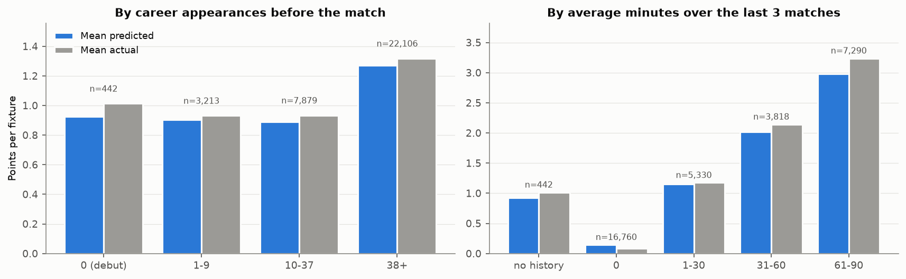

Largest under-predictions (hauls nobody saw coming):

| Season | GW | Player | Pos | Fixture | Predicted | Actual | Min | G | A |
|---|---|---|---|---|---|---|---|---|---|
| 2025-26 | 2 | Jurriën Timber | DEF | Arsenal v Leeds | 2.01 | 24 | 63 | 2 | 1 |
| 2025-26 | 9 | Micky van de Ven | DEF | Spurs v Everton | 3.06 | 23 | 90 | 2 | 0 |
| 2025-26 | 17 | Keane Lewis-Potter | DEF | Brentford v Wolves | 1.92 | 21 | 90 | 2 | 0 |
| 2025-26 | 32 | Konstantinos Mavropanos | DEF | West Ham v Wolves | 2.82 | 21 | 90 | 2 | 0 |
| 2025-26 | 16 | Callum Hudson-Odoi | MID | Nott'm Forest v Spurs | 1.99 | 19 | 90 | 2 | 1 |
| 2025-26 | 38 | Patrick Dorgu | DEF | Man Utd v Brighton | 1.20 | 18 | 61 | 1 | 1 |
| 2026-27 | 2 | Bruno Borges Fernandes | MID | Man Utd v Ipswich | 6.46 | 23 | 90 | 3 | 1 |
| 2026-27 | 6 | Jordan Henderson | MID | Chelsea v Bournemouth | 1.56 | 18 | 90 | 2 | 1 |
| 2025-26 | 16 | Ibrahim Sangaré | MID | Nott'm Forest v Spurs | 1.58 | 18 | 90 | 1 | 2 |
| 2025-26 | 18 | Kevin Schade | MID | Brentford v Bournemouth | 3.74 | 20 | 90 | 3 | 0 |

Largest over-predictions (confident picks that blanked):

| Season | GW | Player | Pos | Fixture | Predicted | Actual | Min | G | A |
|---|---|---|---|---|---|---|---|---|---|
| 2025-26 | 38 | Erling Haaland | FWD | Man City v Aston Villa | 6.60 | 0 | 0 | 0 | 0 |
| 2025-26 | 2 | Cole Palmer | MID | Chelsea v West Ham | 6.59 | 0 | 0 | 0 | 0 |
| 2025-26 | 36 | Erling Haaland | FWD | Man City v Crystal Palace | 6.57 | 0 | 0 | 0 | 0 |
| 2025-26 | 6 | Trevoh Chalobah | DEF | Chelsea v Brighton | 3.36 | -3 | 52 | 0 | 0 |
| 2025-26 | 5 | Robert Lynch Sánchez | GK | Chelsea v Man Utd | 3.30 | -3 | 4 | 0 | 0 |
| 2025-26 | 29 | Micky van de Ven | DEF | Spurs v Crystal Palace | 3.15 | -3 | 37 | 0 | 0 |
| 2025-26 | 3 | Anthony Elanga | MID | Newcastle v Leeds | 6.74 | 1 | 28 | 0 | 0 |
| 2025-26 | 13 | Mohamed Salah | MID | Liverpool v West Ham | 5.69 | 0 | 0 | 0 | 0 |
| 2025-26 | 13 | Erling Haaland | FWD | Man City v Leeds | 7.67 | 2 | 90 | 0 | 0 |
| 2025-26 | 12 | Erling Haaland | FWD | Man City v Newcastle | 7.61 | 2 | 90 | 0 | 0 |

## Limitations and future work

- **No historical availability data.** Injuries, suspensions and rotation news aren't in the training data, so the model predicts an expected value over "plays" and "doesn't play". Adding the FPL status/chance-of-playing history (or a separate minutes model) is the most promising improvement.
- **Player identity is a name string.** In the test seasons 10 (fixture, name) pairs have two rows (Ben Gannon-Doak, Junior Kroupi), and 0 player-gameweeks mix two teams; such players' form features blend two records. A player whose name is spelt differently across seasons also loses his history.
- **Small current-season sample.** 2026-27 has 6 gameweeks, so its intervals are wide and early-season effects dominate it.
- **xG features exist only from 2023-24.** Earlier training seasons have them missing, so the model learns xG-based form from one training season.
- **Irreducible noise.** The oracle top-20 is 11.20 against v3's 4.70, but the oracle uses outcomes; a model told the match's own minutes, starts and xG/xA/xGC still only reaches R² 0.55 (MAE 0.666), and knowing each player-season's true average explains about 0.32 of the per-fixture variance. Goals, assists and bonus are rare and lumpy, so large single-match errors are expected.
- **Single model, squared-error objective.** A Tweedie/zero-inflated objective or a two-stage minutes x points model could fit the zero-inflated target better; ranking objectives (pairwise) could target pick quality directly.

## Production model check

The deployed `ml/models/points_v3.json` (174 trees, refit on 2020-21, 2021-22, 2022-23, 2023-24, 2024-25, 2025-26, 2026-27) scored on the same test rows: MAE 0.925, R² 0.441, Spearman 0.744, captain 10.34, top-20 7.09. **This is optimistic**: the production model was trained on these seasons. It only confirms that the deployed file loads and behaves like the evaluated one; the honest numbers are the ones above.

Cross-check: `ml.points_model.evaluate` on this run's v3 predictions gives top-20 4.700 / MAE 1.007 (combined), versus 4.700 / 1.007 in `ml/models/points_v3_report.json`.

## How to reproduce

```bash
.venv/Scripts/python.exe -m ml.evaluate_points_v3            # writes docs/ml_evaluation/
.venv/Scripts/python.exe -m ml.evaluate_points_v3 --n-boot 500 --perm-repeats 1   # quicker
```

Environment of this run: Python 3.11.17, XGBoost 3.2.0, pandas 3.0.6. Seeds are fixed (XGBoost seed 0 as in training, NumPy streams derived from seed 42); reruns on the same data reproduce the numbers. When the current-season file grows, the 2026-27 numbers change with it.
